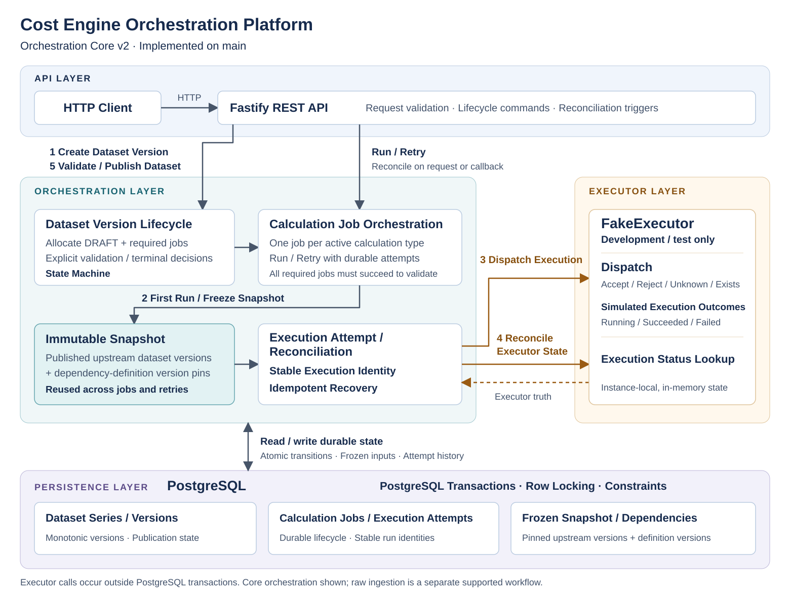
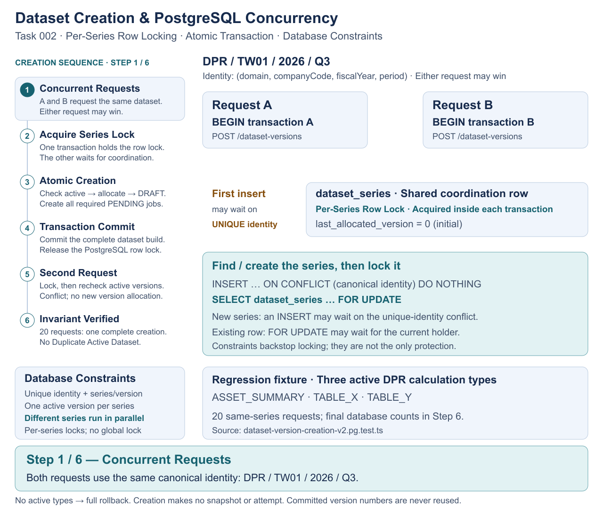
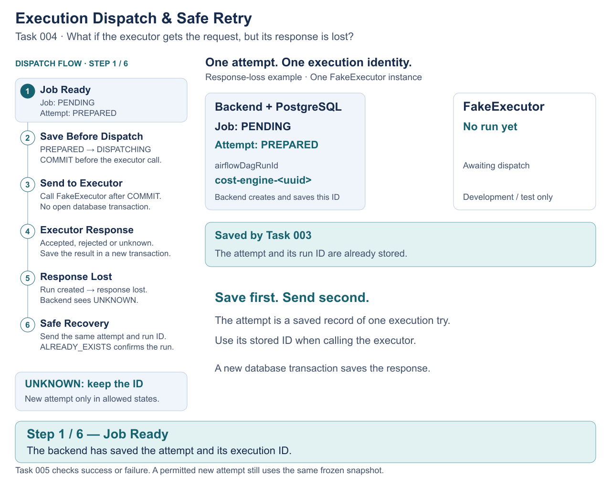

# Cost Engine Orchestration Platform

## What Is This Project?

This backend coordinates builds of versioned cost and financial datasets.
It tracks which inputs each build uses, runs calculation jobs through an executor, and controls when a dataset can be published.
PostgreSQL keeps concurrent requests and recovery steps consistent.
The backend owns orchestration; it does not perform financial calculations.
This is a portfolio implementation, not a copy of a former employer's production system.

**Start here:** read the architecture below, then watch concurrent dataset creation and dispatch recovery.
For design decisions and test evidence, use [Explore the Engineering Design](#explore-the-engineering-design).

## Tech Stack

| Technology | Purpose |
|---|---|
| TypeScript / Node.js | Backend application |
| Fastify | REST APIs |
| PostgreSQL | Persistent state, transactions and constraints |
| FakeExecutor | Simulates external job execution for development and tests |
| Docker Compose | Local PostgreSQL environment |

## System Architecture



| Component | Responsibility |
|---|---|
| API layer | Accepts HTTP commands and checks request input. |
| Domain services | Apply dataset, job and attempt rules. |
| PostgreSQL | Saves state and coordinates conflicting changes with transactions, row locks and constraints. |
| Calculation jobs | Track each required calculation within a dataset version. |
| Executor | Handles dispatch and status lookup. Only FakeExecutor is implemented. |

FakeExecutor does not calculate financial results. Its runs and rejection records live in one process's memory; they do not provide recovery across restarts.
There is no real Airflow adapter. See the [API and backend reference](docs/REFERENCE.md#registered-api-surface) for supported routes.

## How It Works

These are explicit API commands and checks, not an automatic pipeline:

1. **Create Dataset:** create a DRAFT version and a PENDING job for each active calculation type.
2. **Freeze Inputs:** the first Run freezes published upstream versions and dependency definitions for the whole dataset version.
3. **Run Jobs:** Run dispatches each job using those frozen inputs. Preparation alone creates a PREPARED attempt; it does not mean the executor accepted it.
4. **Check Results:** manual reconciliation or a callback triggers a lookup of the executor's actual state.
5. **Validate:** Submit Validation checks that every required job succeeded, then moves the dataset to VALIDATING.
6. **Publish:** an explicit Publish command releases the validated dataset.

**Failure / Retry:** an eligible retry after confirmed failure creates a new execution attempt with the same frozen inputs.
An uncertain dispatch result (`UNKNOWN`) keeps the same DISPATCHING attempt and execution identity for recovery; it is not a failure.

**Reject:** a VALIDATING dataset can be rejected instead of published.
**Abandon:** a DRAFT or BUILDING dataset can be abandoned only when no PREPARED, DISPATCHING or ACCEPTED attempt exists. Abandon does not cancel executor work.

Job success does not publish a dataset. Checks run only when requested or triggered by callbacks; there is no periodic reconciliation worker.

## Key Engineering Concepts

| Concept | Why It Matters |
|---|---|
| Transaction | Saves related changes together, or rolls them all back. |
| Row Lock | Orders conflicting changes to the same rows. Different dataset series need no shared global application lock. |
| Idempotency | Reuses an attempt's saved execution identity. Avoiding duplicate execution also requires the executor to enforce that identity. |
| Immutable Snapshot | Keeps every job and retry on the same frozen inputs within one dataset version. |
| Reconciliation | Checks executor truth before updating stored job and attempt state. |
| State Machine | Allows only valid status changes and protects terminal history. |

## Animated Engineering Flows

### Task 002 — Concurrent Dataset Creation



**Problem:** concurrent requests may try to create the same dataset.

**Solution:** a per-series row lock orders the requests. One transaction saves the dataset and its jobs; database constraints protect the invariants.

**Key Engineering Concepts:** per-series row locking, atomic transactions, database constraints and conflict handling.

[Static SVG](docs/diagrams/flows/task-002-dataset-creation.svg) · [Implementation Details](docs/ENGINEERING_FLOWS.md#task-002--dataset-creation)

### Task 004 — Execution Dispatch & Safe Retry



**Problem:** the executor may start a run but lose its response.

**Solution:** commit the attempt before dispatch. Recover an UNKNOWN result using the same attempt and saved DAG/run identity. Avoiding duplicate runs also requires the executor to enforce that identity.

**Key Engineering Concepts:** durable execution attempts, commit before external calls, stable execution identity and executor idempotency.

[Static SVG](docs/diagrams/flows/task-004-execution-dispatch.svg) · [Implementation Details](docs/ENGINEERING_FLOWS.md#task-004--execution-dispatch)

All five animations, including Snapshot, Reconciliation and Dataset Lifecycle, remain in the [Engineering Flows gallery](docs/ENGINEERING_FLOWS.md). Follow them in execution order:

| Task | Engineering question |
|---|---|
| [002 — Dataset Creation](docs/ENGINEERING_FLOWS.md#task-002--dataset-creation) | What happens when requests create the same dataset at once? |
| [003 — Immutable Snapshot](docs/ENGINEERING_FLOWS.md#task-003--immutable-snapshot) | How do jobs keep using the same inputs? |
| [004 — Execution Dispatch](docs/ENGINEERING_FLOWS.md#task-004--execution-dispatch) | How is a lost executor response recovered? |
| [005 — Executor Reconciliation](docs/ENGINEERING_FLOWS.md#task-005--executor-reconciliation) | How does stored state catch up with the executor? |
| [006 — Dataset Lifecycle](docs/ENGINEERING_FLOWS.md#task-006--dataset-lifecycle) | How are competing publication decisions handled? |

## Run Locally

Requires Node.js 24+, npm and Docker Compose. The Compose service uses PostgreSQL 18.

1. Run `npm ci`.
2. Create a private `.env` from [.env.example](.env.example) **only if it does not already exist**. Set a local `DATABASE_URL` and matching `POSTGRES_USER`, `POSTGRES_PASSWORD` and `POSTGRES_DB`. Replace example credentials; never commit secrets. Keep `NODE_ENV=development` and `EXECUTOR_TYPE=fake`.
3. Start the database, apply migrations and start the backend:

   ```bash
   docker compose up -d postgres_db
   npm run migrate -- up
   npm run dev
   ```

The server defaults to port 3000 on `0.0.0.0`. Use a trusted local environment: Domain APIs remain unauthenticated, and fake controls are development/test tools.
Do not expose this application publicly. The executor factory rejects fake execution in production.

A fresh database is not a configured calculation pipeline. Active calculation types and published dependency definitions must be configured in PostgreSQL; there is no general seed command or management API. The explicit [Demo-02A seed](docs/tasks/demo-02a-shared-seed-read-apis.md) prepares only a minimal local Demo CAPEX configuration and also documents the protected read APIs.
Do not edit applied migrations or delete persistent data to bypass migration guards.
See [local setup and migration notes](docs/REFERENCE.md#local-development).

Build and run the milestone tests against a **dedicated local PostgreSQL test service**:

```bash
npm run build
npm run test:milestone
```

On Windows, use `npm.cmd` if PowerShell blocks `npm`.
Privately configure `TEST_DATABASE_URL` (fallback: `DATABASE_URL`) for a safe test service. Its role needs CREATE DATABASE, ownership/DDL/drop rights for its disposable databases, and access to `postgres`. Never use production.
**Do not run the standalone raw-ingestion test against a persistent database**; the milestone runner uses an isolated launcher.
Read the [test setup and gate rules](docs/REFERENCE.md#verification) before running database tests.

## Explore the Engineering Design

| Document | What You Can Learn |
|---|---|
| [Architecture](docs/ARCHITECTURE.md) | Model, transaction boundaries and lock ordering |
| [Engineering Flows](docs/ENGINEERING_FLOWS.md) | Five animations with short implementation tables |
| [Task Specifications](docs/tasks/) | Bounded implementation requirements and review history |
| [ADRs](docs/adr/README.md) | Why technical decisions were made |
| [Verification](docs/verification/) | Recorded test runs and their exact source revisions |
| [Final Acceptance](docs/verification/task-007-final-acceptance.md) | Task 007 completion, approval and evidence boundaries |
| [Backend Reference](docs/REFERENCE.md) | Identity, API routes, local setup and testing details |
| [Roadmap](docs/ROADMAP.md) | Completed scope and deferred work |
| [Diagram Sources](docs/diagrams/flows/README.md) | How to edit and regenerate the animations |
| [Engineering Policy](AGENTS.md) | Repository change and review rules |

Task 007 / Orchestration Core v2 is complete and accepted. This is an evolving portfolio project with no production-readiness claim.
Canonical domains remain `FAB_COST`, `CAPEX`, `DPR`, `INSURANCE`, `ONE_STD_COST` and `COWOS_S`.

Demo 01A and Demo 01B-1 are merged. Explicit APP_MODE=demo protects Demo commands
and uses one FakeExecutor per session; default core APIs remain unauthenticated.
Demo 01B-2 adds atomic owner-scoped Reset, backend cookie clearing and startup
invalidation of old sessions. It remains single-instance and development/test only.
See the [Demo API/recovery reference](docs/REFERENCE.md#protected-demo-runtime)
and [B2 scope and verification](docs/tasks/demo-01b2-session-reset-recovery.md).
Demo-02B adds durable Scenario Create/Get; Demo-02C adds explicit Happy Path Next
steps with a durable request ledger and recovery. See the
[Demo-02C contract and verification](docs/tasks/demo-02c-happy-path-step-execution.md).
Demo-02D adds the nine-step [Failure Retry Scenario](docs/tasks/demo-02d-failure-retry-scenario.md)
using the same Job/frozen inputs and a new Attempt without rewriting failed history.
No frontend, Lost Response Scenario or automatic background execution is implemented.
Real Airflow integration, cancellation, queues, background workers, automatic publication and production authentication/authorization are not implemented.
