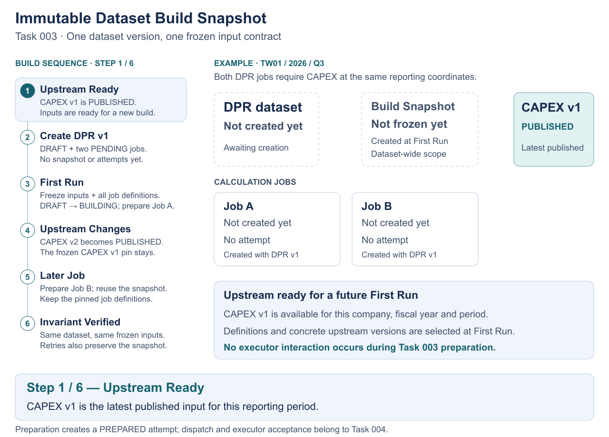
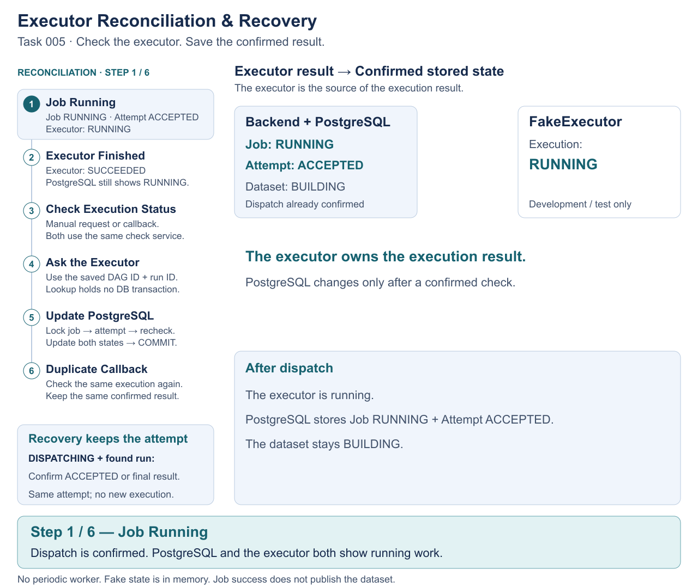

# Cost Engine Orchestration Platform

A portfolio backend for coordinating versioned cost/financial datasets and external calculation executions. The backend owns orchestration, reproducibility, concurrency and publication state; it does not execute financial calculation logic or contain a previous employer's proprietary Airflow/ETL implementation.

## System Architecture


The backend orchestrates dataset and execution lifecycles; it does not perform financial calculations. PostgreSQL persists orchestration state and enforces consistency through transactions, row locking and constraints. FakeExecutor is the development/test adapter that simulates external dispatch and execution outcomes; no real Airflow adapter is implemented.

## Core Engineering Flows

### 1. Immutable Dataset Build Snapshot



**Problem:** Upstream data may change while a dataset is being built. **Solution:** First Run freezes published upstream versions and pins dependency definitions for every job. **Guarantee:** All jobs and retries within the same Dataset Version reuse consistent, immutable inputs.

Task 003 prepares an attempt as `PREPARED` while its job remains `PENDING`; dispatch and executor acceptance belong to Task 004.

[View the complete static SVG](docs/diagrams/flows/task-003-immutable-snapshot.svg) · [Regenerate the animation](docs/diagrams/flows/README.md)

### 2. Dataset Creation & PostgreSQL Concurrency


**Problem:** Concurrent requests may create the same dataset. **Solution:** Per-series row locking, one atomic transaction and database constraints coordinate creation. **Guarantee:** One active Dataset Version and a complete job set; conflicting requests return `409 ACTIVE_DATASET_VERSION_EXISTS` without allocating another version. Different series can proceed without a shared global lock.

The PostgreSQL regression with three active calculation types asserts that 20 same-series requests produce **1 × HTTP 201, 19 × HTTP 409, 1 Dataset Series, 1 DRAFT Dataset Version, 3 PENDING Jobs, and Version Counter = 1**.

[View the complete static SVG](docs/diagrams/flows/task-002-dataset-creation.svg) · [Regenerate the animation](docs/diagrams/flows/README.md#task-002-dataset-creation)

### Execution Dispatch & Safe Retry


**Problem:** The executor may start a job, but its response can be lost.

**Solution:** The backend saves an execution ID before dispatching and reuses it when the result is unknown.

**Guarantee:** The same attempt keeps the same execution identity. Avoiding duplicate runs also requires the executor to check that identity; retrying HTTP alone is not enough.

The animation shows one FakeExecutor response-loss case: the run exists, so sending the same ID returns `ALREADY_EXISTS`. Other `UNKNOWN` results may stay unresolved. FakeExecutor is for development/test; its run records are in memory within one instance.

#### Implementation Details

| Concept | How It Works |
|---|---|
| PostgreSQL | Saves each execution attempt. |
| Transaction | Commits before the executor call. A new transaction saves the result. |
| Execution ID | The backend creates and stores `airflowDagId` + `airflowDagRunId` for each attempt. |
| Idempotency | The executor checks the same ID and reuses an existing run. |
| UNKNOWN | Keeps the attempt `DISPATCHING` and the job unchanged for recovery. |
| REJECTED | Guarantees no run exists or can ever be created for that identity; records `DISPATCH_FAILED`. |
| Retry | Creates a new attempt only when job/attempt state permits, using the same frozen snapshot. |

Task 005 checks the executor's final success or failure. Task 004 confirms dispatch; it does not mark the job `SUCCEEDED` or `FAILED`.

[View the complete static SVG](docs/diagrams/flows/task-004-execution-dispatch.svg) · [Regenerate the animation](docs/diagrams/flows/README.md#task-004-execution-dispatch)

### Executor Reconciliation & Recovery



**Problem:** A job may finish while the backend still shows it as running.

**Solution:** The backend checks the executor and updates the stored state.

**Guarantee:** Only confirmed executor results can complete a job.

#### Implementation Details

| Concept | How It Works |
|---|---|
| Reconciliation | Checks the executor's result against stored state. |
| Executor Lookup | Uses saved `airflowDagId` + `airflowDagRunId`, outside database transactions. |
| Transaction | Rechecks state and updates job and attempt together. |
| Row Lock | Locks the job first, then the attempt, to prevent conflicting updates. |
| Callback | Triggers the same check as manual `/reconcile`; it cannot set a result. |
| Idempotency | Repeated checks of the same confirmed result keep completed state unchanged. |

#### Other Results and Recovery

Open attempts (`DISPATCHING` or `ACCEPTED`) follow the lookup results below. Once complete, a matching duplicate keeps the saved result.

| Executor Result | Backend Behavior |
|---|---|
| RUNNING | Confirm attempt `ACCEPTED` and job `RUNNING`. |
| SUCCEEDED | Mark job and attempt `SUCCEEDED` together. |
| FAILED | Mark job and attempt `FAILED` together. |
| NOT_FOUND / UNAVAILABLE | Keep local state unchanged; return `503 EXECUTOR_STATUS_UNAVAILABLE`. |
| Duplicate callback with the same final result | Keep the confirmed result; no new attempt or execution. |

**UNKNOWN dispatch recovery:** A `DISPATCHING` attempt can become `ACCEPTED` when the executor reports RUNNING, or go directly to a confirmed SUCCEEDED/FAILED result. It keeps the same attempt and execution ID.

**Old callbacks:** A result for an older attempt cannot overwrite a newer retry. Completed attempts never move back to RUNNING. Conflicting final results raise an invariant error and keep stored history unchanged. Old callbacks are checked, not all silently ignored.

Only manual and callback-triggered checks are implemented; there is no periodic worker. Job success does not publish the dataset. FakeExecutor is for development/test, and its in-memory state does not survive a restart.

[View the complete static SVG](docs/diagrams/flows/task-005-executor-reconciliation.svg) · [Regenerate the animation](docs/diagrams/flows/README.md#task-005-executor-reconciliation) · [Task 005 specification](docs/tasks/005-executor-reconciliation.md)

## Accepted milestone baseline

The Orchestration Core v2 milestone is **completed and accepted**: Task 007 COMPLETE; Orchestration Core v2 ACCEPTED. The implemented orchestration scope for Tasks 002–007 is complete, and Tasks 007A–007E are merged. System Owner final acceptance is recorded on 2026-10-16 (Asia/Taipei) in the [final acceptance record](docs/verification/task-007-final-acceptance.md).

The broader platform remains an evolving portfolio project. This milestone does not include production Airflow integration or claim production deployment readiness. The final acceptance record distinguishes the tested source from the implementation merge and this pending documentation-only closure; historical verification reports remain unchanged.

See [Roadmap](docs/ROADMAP.md), [Task 007 master scope](docs/tasks/007-end-to-end-hardening-and-legacy-cleanup.md), [Task 007E](docs/tasks/007e-legacy-and-documentation-cleanup.md), [historical Task 007D verification](docs/verification/task-007d-milestone.md) and [Task 007E audit/verification](docs/verification/task-007e-cleanup.md).

## Implemented model

```text
Dataset Series (domain, company_code, fiscal_year, period)
└── Dataset Versions
    ├── Immutable Dataset Build Snapshot (after first Run)
    │   └── Frozen upstream published dataset versions
    └── Calculation Jobs (one per snapshotted active calculation type)
        ├── Frozen dependency-definition version (after first Run)
        └── Execution Attempts
            └── FakeExecutor external execution identity
```

Canonical domains are exactly:

```text
FAB_COST  CAPEX  DPR  INSURANCE  ONE_STD_COST  COWOS_S
```

Aliases such as `FAB COST` or `COWOS-S` are not normalized. Period is Q1–Q4; fiscal year is a positive integer.

### Creation and frozen inputs

`POST /dataset-versions` accepts only this identity:

```json
{
  "domain": "DPR",
  "companyCode": "TW01",
  "fiscalYear": 2026,
  "period": "Q3"
}
```

One transaction safely finds/creates and locks the canonical series, checks for an active version, increments `last_allocated_version`, inserts a DRAFT version, and creates a PENDING job for every active calculation type in the domain. The 201 response contains `datasetSeriesId`, `datasetVersionId`, `version`, `datasetStatus` and `calculationJobs` (job/type identities and job status).

A series can have only one DRAFT/BUILDING/VALIDATING version. Version numbers are monotonic and never reused after rejection or abandonment. The counter is not a latest-published or active-version pointer. No active calculation types means 409 CALCULATION_TYPE_NOT_CONFIGURED and complete rollback, including a newly created series.

Creation does not resolve dependencies. First Run freezes the latest PUBLISHED dependency-definition version for every job, derives required direct upstream domains using the same company/year/period, and selects their latest PUBLISHED dataset versions under the accepted locks. It atomically creates one dataset-wide snapshot, pins all job definitions, moves DRAFT to BUILDING and prepares the selected attempt. A published zero-dependency definition is valid; missing configuration is not.

All jobs and retries reuse this frozen build contract. Later publications or configuration changes do not refresh it. Each dispatched job receives only its required dependency subset, not the union for every job.

### Run, retry and reconciliation

`POST /calculation-jobs/:jobId/run` routes from durable job/attempt state. The platform generates each attempt's stable `(airflow_dag_id, airflow_dag_run_id)`; HTTP callers do not choose execution or data identity.

Durability boundaries are separate:

```text
A: prepare/reuse PREPARED attempt; commit
B: mark/reuse DISPATCHING and read frozen command; commit
   executor.dispatch — no open orchestration transaction/locks
C: record outcome atomically; commit
```

- ACCEPTED or ALREADY_EXISTS confirms the same external identity: attempt ACCEPTED and job RUNNING.
- REJECTED is an irrevocable, identity-wide guarantee that this execution never existed and cannot later be created (ADR-0008). Record DISPATCH_FAILED, leave job PENDING/FAILED, return 502 EXECUTOR_DISPATCH_FAILED.
- UNKNOWN remains DISPATCHING and normally returns 202 with the same attempt/run identity. Recovery redispatches that identity or reconciles it, rather than allocating a new attempt. Already-confirmed/terminal durable state is not regressed by late responses.
- An already ACCEPTED/RUNNING job returns durable state without redispatch. A definite dispatch failure or reconciled calculation failure can be retried with a new attempt number and identity, against the same snapshot.

`POST /calculation-jobs/:jobId/reconcile` queries executor truth outside DB transactions, then locks/revalidates job and attempt in canonical order before applying atomic updates. Confirmed terminal executor results produce SUCCEEDED/FAILED job and attempt states. NOT_FOUND/unavailability does not infer failure. Stale terminal observations cannot overwrite a newer retry.

`POST /executor-callbacks/airflow` accepts only `airflowDagId` and `airflowDagRunId`. It triggers the same reconciliation path; callback-reported terminal state is not authoritative. Periodic/background reconciliation is not implemented.

### Validation and terminal decisions

Dataset states are DRAFT → BUILDING → VALIDATING → PUBLISHED or REJECTED; DRAFT/BUILDING may instead become ABANDONED. There is no dataset-level FAILED.

All required jobs must succeed before explicit Submit Validation. Job completion does not automatically validate or publish. Publish/Reject require VALIDATING. Abandon rejects any PREPARED/DISPATCHING/ACCEPTED attempt and does not cancel external executions. Same-target lifecycle commands are idempotent; conflicting terminal decisions return STATE_CONFLICT and never rewrite history.

### Supported raw ingestion

Raw ingestion is a separate supported bounded feature, not obsolete calculation-job creation. `POST /raw-ingestion-batches` accepts exactly `domain` and `businessKey`, for FAB_COST_RAW, CAPEX_RAW or DPR_RAW. It atomically allocates a LOADING batch and returns 201 with `batchId`, `ingestionSeriesId`, `batchSequence` and `status`. An active batch returns 409 ACTIVE_RAW_INGESTION_BATCH_EXISTS. Its identity/model and historical data are retained; this businessKey is not canonical orchestration dataset identity.

## Registered API surface

| Method | Route | Purpose |
|---|---|---|
| GET | /health | Database connectivity/time (Fastify also generates HEAD) |
| POST | /demo/sessions | Create a four-hour session (201), or reuse a valid cookie (200) |
| GET | /demo/sessions/current | Restore a valid session from its HttpOnly cookie (200) |
| POST | /dataset-versions | Atomic dataset/job creation (201) |
| POST | /dataset-versions/:datasetVersionId/submit-validation | Explicit readiness transition |
| POST | /dataset-versions/:datasetVersionId/publish | Publish validated dataset |
| POST | /dataset-versions/:datasetVersionId/reject | Reject validated dataset |
| POST | /dataset-versions/:datasetVersionId/abandon | Safely abandon DRAFT/BUILDING |
| POST | /calculation-jobs/:jobId/run | Dispatch or retry (200; unresolved DISPATCHING is 202) |
| POST | /calculation-jobs/:jobId/reconcile | Reconcile selected durable attempt |
| POST | /executor-callbacks/airflow | Reconciliation trigger by stored external identity |
| POST | /raw-ingestion-batches | Raw batch allocation (201) |

Executor-backed routes require executor injection into `buildApp`; `src/server.ts` supplies the explicitly configured executor.

### Demo Session foundation (Demo 01A)

Session creation accepts an empty JSON object with `X-Demo-Session: 1`; browser
Origin must match the configured/direct origin. Sessions have a fixed four-hour
lifetime, no sliding extension, and hash-only credential persistence. Invalid,
expired or revoked cookies return 401 DEMO_SESSION_UNAVAILABLE. Successful JSON
contains only sessionId, companyCode, expiresAt and status. HTTPS cookies are
Secure/HttpOnly/SameSite=Strict/Path=/; plain HTTP is development/test only.
See [the bounded specification](docs/tasks/demo-01a-session-infrastructure.md)
for cookie names, CSRF, internal revocation, ownership and queue policies.

Ownership validators and the bounded per-session coordinator are foundations
only: **existing Domain APIs remain unchanged and unauthenticated**. This slice
does not provide end-to-end data isolation or make the application safe for an
untrusted public deployment. No protected Domain API or scenario runner exists.
Focused verification: `npm run test:demo-session-infrastructure`, against its
own disposable migrated PostgreSQL database, alongside the unchanged milestone.

Only with an injected FakeExecutor and an explicitly approved development/test environment:

| Method | Internal route | Purpose |
|---|---|---|
| POST | /internal/fake-executor/executions/:dagRunId/succeed | Set in-memory fake execution to SUCCEEDED |
| POST | /internal/fake-executor/executions/:dagRunId/fail | Set in-memory fake execution to FAILED |

These controls do not reconcile DB state automatically and are not production APIs. No read/list API is implemented. Legacy POST /calculation-jobs and job-level start/submit-validation/publish/reject/fail routes are not registered.

Handled API errors use the flat envelope:

```json
{ "message": "...", "code": "..." }
```

Representative contracts: 400 INVALID_REQUEST/INVALID_DOMAIN/INVALID_PERIOD; 404 CALCULATION_JOB_NOT_FOUND/DATASET_VERSION_NOT_FOUND/EXECUTION_ATTEMPT_NOT_FOUND; 409 lifecycle/readiness/active-version conflicts; 502 EXECUTOR_DISPATCH_FAILED; 503 EXECUTOR_STATUS_UNAVAILABLE. Parser body-size/media errors use 413/415 with INVALID_REQUEST. Unexpected failures are logged and return 500 INTERNAL_SERVER_ERROR without PostgreSQL details. Unregistered routes retain Fastify's normal 404 response. See [API coverage inventory](docs/tasks/007c-api-error-contract-coverage.md) and the executed verification reports for the full contracts.

## Local development

Requirements: Node.js 24+, npm, Docker/Compose and PostgreSQL (repository Compose uses PostgreSQL 18).

1. Install dependencies with `npm ci`.
2. Create a private `.env` from `.env.example` only if one does not already exist. Configure a local DATABASE_URL and the matching Compose POSTGRES_USER/POSTGRES_PASSWORD/POSTGRES_DB. Replace example credentials; never commit secrets.
3. Explicitly select dev-only execution:

   ```dotenv
   NODE_ENV=development
   EXECUTOR_TYPE=fake
   PORT=3000
   ```

4. Start PostgreSQL and apply the existing migrations:

   ```bash
   docker compose up -d postgres_db
   npm run migrate -- up
   npm run dev
   ```

The server binds port 3000 by default on 0.0.0.0; use it only in a trusted local development environment. Fake controls are not authenticated production controls. The factory rejects fake in production and fails closed without an explicit development/test environment or executor selection. There is no implemented real Airflow adapter to select.

Calculation types and published dependency definitions must be configured in PostgreSQL before their corresponding workflows can succeed. There is no management API or general seed command for that configuration; the integration suites install their own fixtures. A fresh migrated database alone is not a preconfigured financial pipeline.

All six historical migrations are retained. The v2 migration deliberately rejects unsafe/ambiguous legacy data and unsupported down conversions instead of discarding history. Do not edit applied migrations or delete/truncate a persistent developer database to bypass a migration guard.

## Verification

Against a dedicated local PostgreSQL test service:

```bash
npm run build
npm run test:milestone
```

On Windows the equivalent commands are `npm.cmd run build` and `npm.cmd run test:milestone`.

Configure TEST_DATABASE_URL, falling back to DATABASE_URL, privately. This is a connection source for the test service, not permission to destroy a persistent application database. The role needs CREATE DATABASE and ownership/DDL/drop privileges for independently owned disposable databases, plus access to the maintenance database `postgres`. Do not use production.

The unchanged milestone runner executes sequentially: build; runner regression tests; schema/migrations; dataset creation; first-run snapshot; dispatch; reconciliation; dataset terminal lifecycle; CON-01/CON-02; focused Task 007B-1; Task 007C contracts; isolated raw ingestion; Task 007D integrated E2E Flow A–F.

Every PostgreSQL suite migrates its own disposable database. The raw-ingestion test is launched through the milestone's isolated wrapper with child-scoped DB URLs and owned teardown. **Do not run the standalone raw-ingestion command against a persistent developer database.**

The gate stops after the first failure, reports remaining commands NOT RUN, and rejects missing/invalid TAP evidence, failures, skips, cancellations or TODOs. A successful exit alone is insufficient for a test suite without valid nonzero passing counters. See the [historical Task 007D report](docs/verification/task-007d-milestone.md) and [Task 007E rerun](docs/verification/task-007e-cleanup.md) for exact revisions, counts and teardown evidence.

## Scope and future work

FakeExecutor is the only implemented adapter: deterministic, in-process, development/test only. External fake runs and identity-rejection tombstones last only for that instance; they are not durable or shared across processes/restarts. It models dispatch acceptance/rejection/response loss and executor status for tests, not real financial computation.

Real Airflow HTTP integration, cancellation, queues, background workers, periodic reconciliation, dependency-management APIs and automatic publication are not implemented. Historical DPR/raw-ingestion schema and the legacy_business_key rollback bridge remain intact.

Accepted decisions: [Architecture](docs/ARCHITECTURE.md), [ADRs](docs/adr/README.md). Engineering/change policy: [AGENTS.md](AGENTS.md).
