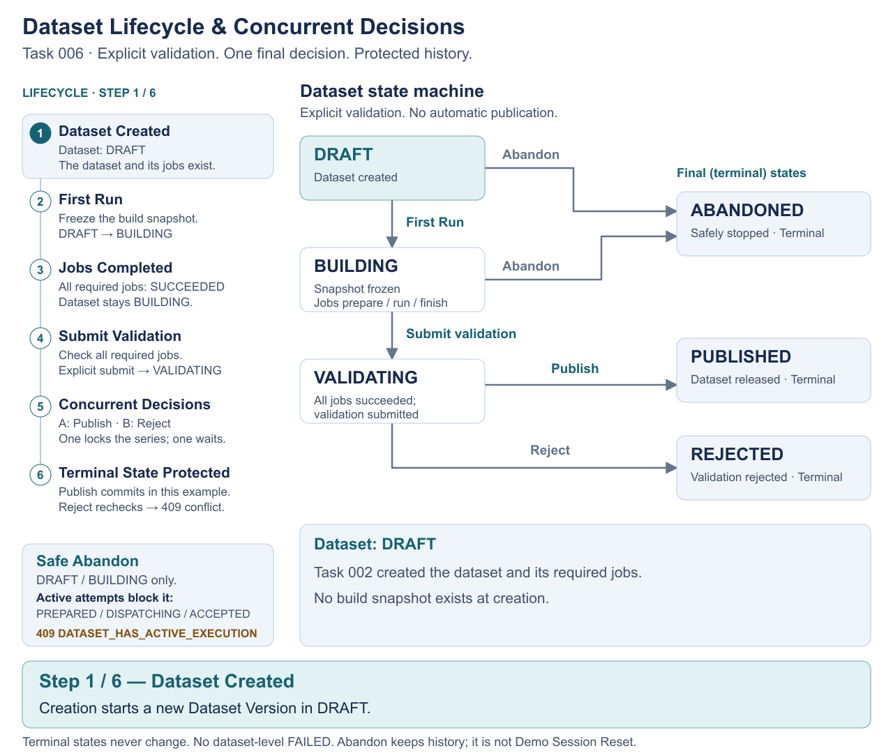

# Engineering Flows

Five short animations explain how a dataset moves from creation to a publication decision. Read them in order, or open a static SVG to inspect a complete flow without animation.

| Task | Main question |
|---|---|
| [002 — Dataset Creation](#task-002--dataset-creation) | How do concurrent requests share a dataset series? |
| [003 — Immutable Snapshot](#task-003--immutable-snapshot) | How are inputs kept consistent across jobs? |
| [004 — Execution Dispatch](#task-004--execution-dispatch) | What if the executor's response is lost? |
| [005 — Executor Reconciliation](#task-005--executor-reconciliation) | How are actual execution results saved? |
| [006 — Dataset Lifecycle](#task-006--dataset-lifecycle) | Who can make the final dataset decision? |

These flows describe the implemented orchestration core. FakeExecutor simulates external behavior for development/tests; it performs no financial calculations. Its in-memory runs and rejection records last only for one instance, with no restart recovery. No real Airflow adapter is implemented.

## Task 002 — Dataset Creation

[Complete static SVG](diagrams/flows/task-002-dataset-creation.svg)

**Problem:** two requests may try to create the same dataset at the same time.

**Solution:** a transaction coordinates creation through the dataset series row. One request creates the dataset and jobs; the other rechecks state and receives a conflict. Either request can win.

### Implementation Details

| Concept | How It Works |
|---|---|
| Canonical identity | A series is `(domain, companyCode, fiscalYear, period)`. SQL uses `company_code` and `fiscal_year`. |
| Transaction | Creates the DRAFT version and all active-type PENDING jobs together. No active calculation types means complete rollback, including a new series and counter allocation. |
| Row lock | `SELECT … FOR UPDATE` on the series orders same-series requests. Different series need no shared global application lock. |
| Unique constraint | Protects series identity; a partial unique index also permits only one DRAFT/BUILDING/VALIDATING version per series. These support the transaction and row lock. |
| First series insert | `INSERT … ON CONFLICT DO NOTHING` may wait for a concurrent unique-identity conflict before reaching the row-lock query. |
| Version counter | Allocates from `dataset_series.last_allocated_version`. Committed version numbers increase and are never reused. |
| HTTP 409 | A waiting request rechecks active state and returns `ACTIVE_DATASET_VERSION_EXISTS` before another counter increment. |

Creation does not select upstream inputs or create a snapshot or execution attempt. The existing PostgreSQL regression configures three active types: 20 concurrent requests produce **1 × 201, 19 × 409, 1 series, 1 DRAFT version, 3 PENDING jobs and counter = 1**. Three jobs is this test's fixture, not a fixed platform count.

Read further: [Task 002 specification](tasks/002-dataset-version-creation-v2.md), [ADR-0001 — identity](adr/0001-canonical-dataset-identity.md), [ADR-0004 — series locking](adr/0004-series-serialization-and-lock-ordering.md).

Verify in code: [creation service](../src/modules/dataset-version/dataset-version.service.ts), [repository](../src/modules/dataset-version/dataset-version.repository.ts), [PostgreSQL concurrency tests](../scripts/dataset-version-creation-v2.pg.test.ts).

## Task 003 — Immutable Snapshot

[Complete static SVG](diagrams/flows/task-003-immutable-snapshot.svg)

**Problem:** upstream data or dependency definitions can change while jobs are being prepared.

**Solution:** First Run freezes one build contract for the whole dataset version. In the example, later DPR jobs still use CAPEX v1 after v2 is published. This dependency is configuration, not a built-in pipeline.

### Implementation Details

| Concept | How It Works |
|---|---|
| Snapshot | Saves selected PUBLISHED upstream versions once for the whole dataset version. |
| Transaction | Freezes upstream inputs and every job's dependency-definition pin together, moves DRAFT to BUILDING, and prepares the selected attempt. Missing required inputs roll back the preparation. |
| Row locks | First Run locks calculation types → upstream series → output dataset version → selected job, in the deterministic order defined by ADR-0006. |
| Version pinning | Jobs keep their selected PUBLISHED dependency-definition versions. Each dispatch uses only the upstream subset required by its pinned definition. |
| Later job | Preparation on the BUILDING dataset reuses the snapshot and pins without resolving newer inputs. |
| Retry | Uses the same frozen contract. Choosing newer upstream data requires a new dataset version. |

Task 003 creates/reuses a **PREPARED** attempt while the initial job remains **PENDING**. Executor dispatch and acceptance belong to Task 004.

Read further: [Task 003 specification](tasks/003-first-run-immutable-build-snapshot.md), [ADR-0003 — snapshots](adr/0003-versioned-dependencies-and-build-snapshot.md), [ADR-0006 — First Run locks](adr/0006-first-run-lock-hierarchy.md).

Verify in code: [preparation service](../src/modules/calculation-job-preparation.service.ts), [snapshot and concurrency tests](../scripts/first-run-immutable-build-snapshot.pg.test.ts), [frozen retry tests](../scripts/execution-attempt-dispatch-fake-executor.pg.test.ts).

## Task 004 — Execution Dispatch

[Complete static SVG](diagrams/flows/task-004-execution-dispatch.svg)

**Problem:** the executor may create a run but lose its response. A new run identity could duplicate the work.

**Solution:** save the attempt and its execution identity before calling the executor. Recover an uncertain result using that same attempt and identity.

### Implementation Details

| Concept | How It Works |
|---|---|
| Execution attempt | A durable row tracks preparation, dispatch and execution state. |
| Execution ID | The backend generates and saves the full `(airflowDagId, airflowDagRunId)` identity before dispatch. Callers do not choose it. |
| Transaction | Preparation commits first; a separate transaction saves DISPATCHING and reads the frozen command. The executor call holds no orchestration transaction/row locks. A new transaction records its result. |
| Idempotency | The same attempt keeps the same identity. Avoiding duplicate runs requires the executor to enforce that identity; an HTTP retry alone is insufficient. |
| ACCEPTED / ALREADY_EXISTS | Atomically saves attempt ACCEPTED and job RUNNING, unless concurrent progress already confirmed a later state. |
| UNKNOWN | Keeps an unresolved attempt DISPATCHING and the job unchanged. Recovery keeps the same identity; it does not allocate a new attempt. |
| REJECTED | Guarantees the run never existed and cannot later be created for that identity. Records DISPATCH_FAILED and returns `502 EXECUTOR_DISPATCH_FAILED`. An executor unable to make this guarantee must use UNKNOWN. |
| Retry after failure | An eligible retry after definite dispatch failure or reconciled execution failure creates a new attempt/identity, keeping the frozen inputs. |

The animation follows FakeExecutor's `ACCEPT_THEN_UNKNOWN` case: a run exists, so sending the same identity again returns ALREADY_EXISTS. Other UNKNOWN cases may remain unresolved. Once acceptance is saved, another Run returns saved state without redispatch. Late responses cannot overwrite terminal history. Task 005 owns confirmed execution success/failure.

Read further: [Task 004 specification](tasks/004-execution-attempt-dispatch-fake-executor.md), [ADR-0005 — identity and reconciliation](adr/0005-execution-attempts-and-airflow-reconciliation.md), [ADR-0008 — definite rejection](adr/0008-identity-scoped-definite-dispatch-rejection.md).

Verify in code: [Run service](../src/modules/calculation-job-run.service.ts), [FakeExecutor](../src/executors/fake-executor.ts), [dispatch and retry tests](../scripts/execution-attempt-dispatch-fake-executor.pg.test.ts).

## Task 005 — Executor Reconciliation

[Complete static SVG](diagrams/flows/task-005-executor-reconciliation.svg)

**Problem:** a job can finish in the executor while PostgreSQL still shows it as running.

**Solution:** look up the saved execution identity, then recheck and update local state in a short transaction.

### Implementation Details

| Concept | How It Works |
|---|---|
| Reconciliation | Executor status is the execution-result authority. Status lookup happens outside database transactions and row locks. |
| Callback | Supplies only the saved DAG/run identity and triggers the same lookup as manual reconciliation. It cannot directly set a status. |
| Transaction | Rechecks current identity, dataset/attempt state and newer retries; saves confirmed job and attempt changes together. A failed write rolls back both. |
| Row lock | Locks the job first, then the attempt, matching dispatch-result recording. |
| Idempotency | A matching repeat preserves terminal state and timestamps. It creates no attempt or external run. |
| Unavailable result | NOT_FOUND, UNAVAILABLE or a thrown lookup error returns `503 EXECUTOR_STATUS_UNAVAILABLE`, preserving local state. It does not prove failure. |
| UNKNOWN recovery | A DISPATCHING attempt can become ACCEPTED/RUNNING or converge directly to confirmed SUCCEEDED/FAILED, keeping the same identity. |

An older attempt cannot overwrite a newer retry's job state. Conflicting terminal observations raise an invariant error without rewriting history. A lookup started before another check completed may return stale RUNNING; revalidation preserves the saved terminal result. A new RUNNING observation for an attempt already terminal at lookup start is an invariant error. Full cases are in the [source notes](diagrams/flows/README.md#older-results-and-retries).

Only manual and callback-triggered checks exist; there is **no periodic reconciliation worker**. Fake controls change only fake executor state. Reconciliation does not validate or publish a dataset.

Read further: [Task 005 specification](tasks/005-executor-reconciliation.md), [ADR-0005](adr/0005-execution-attempts-and-airflow-reconciliation.md).

Verify in code: [reconciliation service](../src/modules/calculation-job-reconciliation.service.ts), [callback route](../src/modules/executor-callback.route.ts), [PostgreSQL recovery tests](../scripts/executor-reconciliation.pg.test.ts).

## Task 006 — Dataset Lifecycle

[Complete state machine SVG](diagrams/flows/task-006-dataset-lifecycle.svg)

**Problem:** successful jobs still need a publication decision, and two requests may try to make opposing decisions.

**Solution:** explicit commands follow a state machine. PostgreSQL row locks order competing final decisions; the loser rechecks and returns a conflict.

### Implementation Details

| Concept | How It Works |
|---|---|
| State machine | DRAFT → BUILDING → VALIDATING → PUBLISHED or REJECTED. DRAFT/BUILDING may become ABANDONED. There is no dataset-level FAILED. |
| Validation | Explicit Submit Validation requires at least one job and every required job SUCCEEDED. Normal incomplete work returns `409 DATASET_NOT_READY_FOR_VALIDATION`. |
| Validation locks | Locks dataset version → jobs (ID order) → attempts (job/attempt-number order), then checks readiness. |
| Row lock | Publish/Reject lock dataset series → dataset version. Either request may win; an opposing request waits and rechecks state. |
| Transaction | Checks and saves each lifecycle change together. Job success alone does not advance dataset state. |
| Terminal state | PUBLISHED, REJECTED and ABANDONED cannot change. Repeating the same completed command returns saved state without rewriting timestamps. |
| Conflict | An invalid or opposing decision returns `409 STATE_CONFLICT`, preserving history. |
| Safe Abandon | Locks series → version → jobs → attempts. Any PREPARED/DISPATCHING/ACCEPTED attempt blocks it with `409 DATASET_HAS_ACTIVE_EXECUTION`. |

Abandon does not cancel executor work or change the frozen snapshot, pins, jobs or attempt history. It is separate from Demo Session Reset. Publish/Reject require VALIDATING; they do not rerun the full job-readiness check.

Read further: [Task 006 specification](tasks/006-validation-and-dataset-terminal-decisions.md), [ADR-0002 — publication unit](adr/0002-dataset-version-publication-unit.md), [ADR-0007 — terminal decisions](adr/0007-dataset-terminal-decisions-and-publication-serialization.md).

Verify in code: [lifecycle service](../src/modules/dataset-version/dataset-version-lifecycle.service.ts), [lifecycle repository](../src/modules/dataset-version/dataset-version-lifecycle.repository.ts), [PostgreSQL lifecycle/race tests](../scripts/dataset-version-terminal-lifecycle.pg.test.ts).

## Sources and Verification

The linked tests specify the illustrated behavior; this gallery is not a report of a new PostgreSQL test run. Recorded execution evidence remains in [Verification](verification/) and the [Task 007 final acceptance record](verification/task-007-final-acceptance.md). Accepted rules remain in [Architecture](ARCHITECTURE.md) and [ADRs](adr/README.md).

To edit a flow, change its generator and regenerate both SVG and GIF. See [diagram sources and generation commands](diagrams/flows/README.md). Return to the [project overview](../README.md) or [backend reference](REFERENCE.md).
